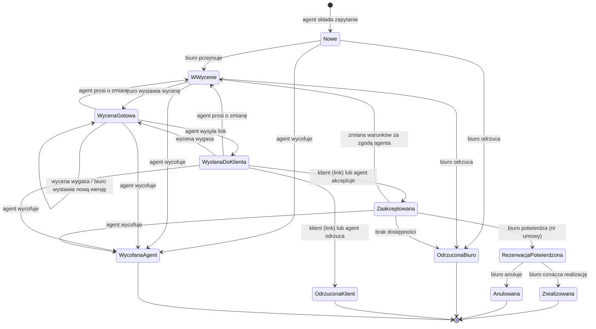

# Portal sprzedaży agencyjnej wycieczek szkolnych — założenia MVP

Data: 2026-10-13 · Status: koncepcja wstępna (prototyp niezależny od obecnego systemu)

## 1. Kontekst i zakres

Biuro podróży organizuje wycieczki szkolne i sprzedaje je przez lokalnych agentów, którzy dostają prowizję od sprzedaży. Portal łączy agentów z biurem: agent wyszukuje oferty, prowadzi swoich klientów i składa zapytania. Biuro publikuje oferty, wycenia zapytania, potwierdza rezerwacje i rozlicza prowizje.

**W zakresie MVP**
- katalog ofert (zarządzanie po stronie biura, wyszukiwanie po stronie agenta),
- prosta kartoteka klientów agenta,
- zapytania z wersjonowanymi wycenami i wątkiem wiadomości,
- publiczny link do wyceny, przez który klient akceptuje albo odrzuca wycenę,
- potwierdzenie rezerwacji, realizacja i anulowanie,
- naliczanie i oznaczanie wypłaty prowizji,
- panel agenta (wymaga akcji, lejek, wyniki, prowizje) i raport agentów dla biura,
- powiadomienia wyłącznie w portalu.

**Poza zakresem MVP**
- umowy, płatności szkoły, faktury i logistyka wyjazdu,
- konto klienta (nauczyciela) w portalu,
- struktura agencji wieloosobowej i role wewnątrz agencji,
- ochrona klienta przed konfliktem kanału, czyli tą samą szkołą zgłoszoną u kilku agentów,
- zapytania bez wskazania oferty z katalogu,
- e-maile, SMS i push (wyjątek: zaproszenie do aktywacji konta),
- zbiorcze zestawienia rozliczeniowe prowizji,
- samorejestracja agentów.

## 2. Słownik

| Pojęcie | Znaczenie |
|---|---|
| **Biuro** | Organizator wycieczek. W portalu jedna rola „Pracownik biura”. |
| **Agent** | Jednoosobowy podmiot sprzedający oferty biura za prowizję. Jeden login to jeden podmiot rozliczeniowy. |
| **Klient** | Osoba, zwykle nauczyciel, dla której agent składa zapytanie. Nie ma konta w portalu. |
| **Oferta** | Szablon wycieczki: program, świadczenia, cena „od” za uczestnika. Nie jest produktem do bezpośredniej rezerwacji. |
| **Zapytanie** | Prośba agenta o wycenę konkretnej oferty dla konkretnej grupy klienta. Główny obiekt procesu sprzedaży. |
| **Wycena** | Wersjonowana propozycja cenowa biura do zapytania, z datą ważności. W danej chwili aktywna jest najwyżej jedna wersja. |
| **Link do wyceny** | Publiczny adres (token) aktywnej wyceny z przyciskami „Akceptuję” i „Odrzucam”. |
| **Rezerwacja** | Zaakceptowane zapytanie potwierdzone przez biuro numerem umowy. |
| **Prowizja** | Procent od wartości sprzedaży, ze statusami: prognozowana → należna → wypłacona albo anulowana. |

## 3. Użytkownicy i ich potrzeby

### 3.1 Agent (sprzedawca zewnętrzny)

**Kim jest:** lokalny przedstawiciel z kontaktami w szkołach. Często pracuje sam, sprzedaje w sezonie i robi to częściowo z telefonu.

**Cele**
- szybko znaleźć ofertę pasującą do potrzeb klasy,
- dostać od biura wycenę bez telefonów i maili,
- domknąć sprzedaż i wiedzieć, ile zarobi.

**Potrzeby**
- wyszukiwarka ofert po regionie, długości wyjazdu i etapie edukacji,
- pełna karta oferty (program, świadczenia, cena „od”, PDF do pokazania klientowi),
- prosta kartoteka klientów z historią ich zapytań,
- złożenie zapytania w minutę, z danymi klienta podpowiadanymi z kartoteki,
- jasny status każdego zapytania i wskazanie, co teraz zależy od niego,
- możliwość negocjacji z biurem (prośba o zmianę, wiadomości),
- link do wyceny, który wyśle klientowi dowolnym kanałem,
- możliwość odnotowania decyzji klienta przekazanej telefonicznie,
- przejrzyste prowizje: ile prognozowane, ile należne, ile wypłacone.

**Bolączki, które portal adresuje:** zapytania i wyceny giną w mailach, agent nie wie, na jakim etapie biuro jest z wyceną, a rozliczenia prowizji są nieprzejrzyste.

**Uprawnienia:** widzi opublikowane oferty, swoich klientów i swoje zapytania. Nie widzi danych innych agentów.

### 3.2 Pracownik biura

**Kim jest:** osoba z działu sprzedaży lub produktu w biurze. W MVP każdy pracownik może wykonać każdą akcję biura.

**Cele**
- utrzymywać aktualny katalog ofert,
- szybko i spójnie wyceniać zapytania agentów,
- mieć kontrolę nad rezerwacjami i rozliczeniem prowizji,
- widzieć, którzy agenci sprzedają.

**Potrzeby**
- edytor oferty z cyklem szkic → opublikowana → wycofana,
- wspólna kolejka zapytań z filtrami i widocznym wiekiem zapytania, żeby nic nie leżało,
- przejęcie zapytania, aby było wiadomo, kto je prowadzi,
- wystawianie wycen i ich kolejnych wersji,
- wątek wiadomości z agentem przy zapytaniu,
- potwierdzenie rezerwacji, oznaczenie realizacji z wartością końcową i anulowanie,
- lista prowizji należnych z możliwością oznaczenia wypłaty,
- zarządzanie kontami agentów i ich stawkami prowizji,
- raport wyników agentów w okresie.

**Uprawnienia:** pełny dostęp do ofert, zapytań, klientów powiązanych z zapytaniami, agentów i prowizji.

### 3.3 Klient (nauczyciel, bez konta)

**Kim jest:** nauczyciel lub wychowawca organizujący wyjazd klasy. Kontaktuje się wyłącznie z agentem.

**Potrzeby**
- czytelna wycena: program, termin, cena za uczestnika, liczba bezpłatnych opiekunów, co jest w cenie, ważność,
- prosta decyzja jednym kliknięciem, bez zakładania konta,
- możliwość podania powodu odrzucenia.

**Uprawnienia:** dostęp tylko do jednej, aktywnej wyceny przez link z tokenem.

### 3.4 System (aktor techniczny)

Pilnuje dat ważności wycen (wygaszanie), przelicza prowizje przy przejściach stanów i zasila liczniki „wymaga akcji”.

## 4. Mapa paneli → use case'y

| Panel (z briefu) | Use case'y |
|---|---|
| Wyszukiwanie ofert (agent) | UC-A2 |
| Rejestracja zapytań i klientów (agent) | UC-A3, UC-A4, UC-A5, UC-A6, UC-A7, UC-A8 |
| Panel agenta (agent) | UC-A9 |
| Zarządzanie ofertami (biuro) | UC-B2 |
| Obsługa zapytań (biuro) | UC-B3, UC-B4, UC-B5, UC-B6, UC-B7, UC-B8, UC-B9 |
| Administracja (biuro, wymagane przez model) | UC-B1 |
| Strona wyceny (klient, publiczna) | UC-K1 |
| Wspólne | UC-A1, UC-S1 |

## 5. Use case'y i przepływy

Konwencja: **PG** – przepływ główny, **PA** – przepływ alternatywny, **W** – wyjątek.

### UC-B1. Założenie, edycja i dezaktywacja konta agenta
- **Aktor:** Pracownik biura
- **Warunki wstępne:** pracownik jest zalogowany.
- **PG:**
  1. Pracownik otwiera „Agenci” i klika „Dodaj agenta”.
  2. Wpisuje nazwę firmy, NIP, imię i nazwisko, e-mail, telefon, region działania i domyślną stawkę prowizji (%).
  3. System waliduje dane (unikalny e-mail i NIP), tworzy agenta w statusie „Zaproszony” i wysyła e-mail z linkiem aktywacyjnym.
  4. Agent pojawia się na liście ze statusem.
- **PA1 – edycja:** pracownik zmienia dane lub stawkę. Nowa stawka dotyczy tylko zapytań zaakceptowanych po zmianie.
- **PA2 – ponowne zaproszenie:** dla statusu „Zaproszony” pracownik może wysłać link ponownie, a stary link traci ważność.
- **PA3 – dezaktywacja:** agent traci możliwość logowania. Jego otwarte zapytania pozostają w kolejce biura, a prowizje należne nadal są rozliczane.
- **W1:** e-mail lub NIP jest już w systemie, więc system pokazuje komunikat i nie tworzy konta.
- **Warunki końcowe:** agent istnieje i może aktywować konto (UC-A1).

### UC-A1. Aktywacja konta i logowanie agenta
- **Aktor:** Agent
- **PG:**
  1. Agent klika link z e-maila.
  2. Ustawia hasło.
  3. System zmienia status na „Aktywny” i loguje agenta.
  4. Agent trafia na panel agenta (UC-A9).
- **PA1 – logowanie:** e-mail i hasło.
- **PA2 – reset hasła:** link wysyłany e-mailem.
- **W1:** link wygasł lub został unieważniony, więc agent widzi komunikat z prośbą o kontakt z biurem.
- **W2:** konto dezaktywowane, więc logowanie jest odrzucone.

### UC-B2. Zarządzanie ofertą
- **Aktor:** Pracownik biura
- **PG – utworzenie i publikacja:**
  1. Pracownik klika „Nowa oferta”.
  2. Uzupełnia kartę: tytuł, region lub kierunek, liczbę dni, etapy edukacji, sezon dostępności (miesiące), cenę „od” za uczestnika, minimalną liczbę uczestników, program dzień po dniu, świadczenia w cenie, świadczenia dodatkowo płatne, zdjęcia i opcjonalny PDF.
  3. Opcjonalnie ustawia stawkę prowizji dla oferty, która nadpisuje stawkę agenta.
  4. Zapisuje ofertę jako szkic.
  5. Podgląda ją w widoku agenta.
  6. Klika „Opublikuj”. System sprawdza pola wymagane do publikacji.
  7. Oferta staje się widoczna dla wszystkich aktywnych agentów.
- **PA1 – edycja opublikowanej oferty:** zmiany są widoczne od razu. Złożone zapytania zachowują migawkę oferty z chwili złożenia.
- **PA2 – wycofanie:** oferta znika z wyszukiwarki i nie można do niej składać nowych zapytań. Otwarte zapytania toczą się dalej.
- **PA3 – przywrócenie:** wycofaną ofertę można opublikować ponownie.
- **PA4 – duplikacja:** „Kopiuj jako szkic” jako szybki start nowej oferty.
- **W1:** brak wymaganych pól przy publikacji, więc system wskazuje braki i oferta pozostaje szkicem.

### UC-A2. Wyszukanie i przegląd oferty
- **Aktor:** Agent
- **PG:**
  1. Agent otwiera „Oferty”.
  2. Filtruje po regionie lub kierunku, liczbie dni (zakres) i etapie edukacji.
  3. Widzi listę kart: tytuł, region, liczba dni, etap, cena „od”, zdjęcie.
  4. Otwiera kartę oferty: program, świadczenia, sezon, minimalna liczba uczestników, PDF i prowizja agenta dla tej oferty.
  5. Klika „Złóż zapytanie”, co uruchamia UC-A4.
- **PA1:** brak wyników, więc system proponuje wyczyszczenie filtrów.
- **PA2:** agent pobiera PDF oferty, żeby pokazać go klientowi.

### UC-A3. Rejestracja i edycja klienta
- **Aktor:** Agent
- **PG:**
  1. Agent otwiera „Klienci” i klika „Dodaj klienta”.
  2. Wpisuje imię, nazwisko, telefon, e-mail, szkołę (tekst), miejscowość i notatkę.
  3. System zapisuje klienta w kartotece agenta.
- **PA1 – w trakcie zapytania:** w UC-A4 agent może dodać nowego klienta bez opuszczania formularza.
- **PA2 – karta klienta:** dane i lista zapytań klienta ze statusami (historia współpracy).
- **PA3 – edycja danych.** Usunięcie jest możliwe tylko dla klienta bez zapytań.
- **W1:** brak telefonu i e-maila, więc wymagany jest co najmniej jeden kanał kontaktu.

### UC-A4. Złożenie zapytania z oferty
- **Aktor:** Agent
- **Warunki wstępne:** oferta jest opublikowana.
- **PG:**
  1. Z karty oferty agent klika „Złóż zapytanie”.
  2. Wybiera klienta z kartoteki lub dodaje nowego (UC-A3 PA1).
  3. Podaje preferowany termin (data wyjazdu i powrotu lub przedział z liczbą dni oferty), liczbę uczniów, liczbę opiekunów, wiek lub klasę, miejsce wyjazdu i uwagi (np. diety, niepełnosprawności, budżet).
  4. System ostrzega, jeśli liczba uczestników jest poniżej minimum oferty albo termin wypada poza sezonem. To ostrzeżenie, nie blokada.
  5. Agent wysyła zapytanie.
  6. Zapytanie dostaje numer i status **Nowe**, a w kolejce biura pojawia się badge.
- **PA1:** agent zapisuje szkic zapytania i wysyła go później.
- **W1:** oferta została wycofana w trakcie wypełniania, więc wysłanie jest zablokowane z komunikatem.

### UC-A5. Wycofanie zapytania przez agenta
- **Aktor:** Agent
- **Warunki wstępne:** status przed „Rezerwacja potwierdzona”.
- **PG:**
  1. Agent na karcie zapytania klika „Wycofaj”.
  2. Podaje powód (lista i tekst).
  3. Status zmienia się na **Wycofana (agent)**, a aktywna wycena i jej link tracą ważność.
- **W1:** po potwierdzeniu rezerwacji wycofanie nie jest możliwe. Agent pisze do biura, które anuluje (UC-B7).

### UC-B3. Przejęcie lub odrzucenie zapytania przez biuro
- **Aktor:** Pracownik biura
- **PG:**
  1. Pracownik otwiera kolejkę z filtrami: status, agent, oferta, termin wyjazdu. Domyślnie sortowanie od najstarszych w statusie **Nowe**.
  2. Otwiera kartę zapytania: dane grupy, klient, agent, migawka oferty, wątek i historia.
  3. Klika „Przejmij”. Status zmienia się na **W wycenie**, a pracownik zostaje osobą obsługującą (informacyjnie, każdy może dalej działać).
  4. Przechodzi do UC-B4.
- **PA1 – odrzucenie:** brak dostępności lub zapytanie niewykonalne. Pracownik podaje powód, status zmienia się na **Odrzucona (biuro)**, a agent widzi powód.
- **PA2 – pytanie do agenta:** pracownik pisze w wątku przed wyceną. Status się nie zmienia, a agent widzi badge.

### UC-B4. Wystawienie wyceny (i kolejnej wersji)
- **Aktor:** Pracownik biura
- **Warunki wstępne:** status **W wycenie**.
- **PG:**
  1. Pracownik klika „Wystaw wycenę”.
  2. Uzupełnia: termin (daty), cenę za uczestnika, przyjętą liczbę uczestników płatnych, liczbę bezpłatnych opiekunów, świadczenia w cenie (domyślnie z oferty, edytowalne), świadczenia opcjonalne z cenami, datę ważności (domyślnie +14 dni) i uwagi dla klienta.
  3. System liczy wartość wyceny jako cenę × liczbę uczestników płatnych oraz prognozowaną prowizję agenta.
  4. Pracownik zatwierdza. Powstaje wycena w wersji N, poprzednia aktywna wersja (jeśli była) dostaje status „Zastąpiona”, a status zapytania zmienia się na **Wycena gotowa**.
  5. Agent widzi badge.
- **W1:** data ważności w przeszłości lub brak ceny, więc walidacja blokuje zapis.

### UC-A6. Przegląd wyceny i wysłanie jej klientowi
- **Aktor:** Agent
- **Warunki wstępne:** status **Wycena gotowa** z aktywną wyceną.
- **PG:**
  1. Agent otwiera zapytanie i widzi wycenę: wartość, ważność i prognozowaną prowizję.
  2. Klika „Wyślij klientowi”. System generuje link do wyceny i pokazuje go z przyciskiem „Kopiuj”.
  3. Agent wysyła link klientowi poza portalem (SMS, e-mail, komunikator).
  4. Status zmienia się na **Wysłana do klienta**.
- **PA1:** agent prosi o zmianę zamiast wysyłać (UC-A7).
- **PA2:** agent może ponownie skopiować link aktywnej wyceny w dowolnym momencie.

### UC-A7. Prośba o zmianę i wiadomości w wątku
- **Aktorzy:** Agent, Pracownik biura
- **PG – prośba o zmianę:**
  1. W statusie **Wycena gotowa** lub **Wysłana do klienta** agent klika „Poproś o zmianę”.
  2. Opisuje oczekiwania, np. „klient chce tańszy hotel” albo „30 uczniów zamiast 25”. Opis trafia do wątku.
  3. Aktywna wycena zostaje unieważniona, a link przestaje działać.
  4. Status zmienia się na **W wycenie**, a biuro widzi badge.
  5. Biuro wystawia nową wersję (UC-B4).
- **PA1 – zwykła wiadomość:** obie strony mogą pisać w wątku w każdym niekońcowym statusie bez zmiany statusu. Druga strona widzi badge.
- **PA2 – załącznik** do wiadomości (np. lista uczestników, PDF).

### UC-K1. Decyzja klienta przez link
- **Aktor:** Klient
- **PG:**
  1. Klient otwiera link.
  2. Widzi stronę wyceny: nazwę oferty, program, termin, cenę za uczestnika, liczbę uczestników, opiekunów gratis, świadczenia, datę ważności i dane kontaktowe agenta.
  3. Klika „Akceptuję” i potwierdza.
  4. Status zmienia się na **Zaakceptowana**. System zapisuje datę, kanał „link” i zamraża stawkę prowizji.
  5. Agent i biuro widzą badge.
- **PA1 – odrzucenie:** klient klika „Odrzucam” i opcjonalnie podaje powód. Status zmienia się na **Odrzucona (klient)**.
- **W1:** wycena zastąpiona, wygasła lub zapytanie zamknięte, więc strona pokazuje komunikat „Wycena nieaktualna – skontaktuj się z agentem” bez przycisków.
- **W2:** decyzja już podjęta, więc strona pokazuje jej wynik.

### UC-A8. Ręczne odnotowanie decyzji klienta przez agenta
- **Aktor:** Agent
- **Warunki wstępne:** status **Wysłana do klienta** z aktywną wyceną.
- **PG:**
  1. Agent klika „Klient zaakceptował” albo „Klient odrzucił”.
  2. Podaje adnotację, np. „telefonicznie 12.11”.
  3. Skutek jest taki jak w UC-K1, a historia pokazuje kanał „agent” i adnotację.

### UC-S1. Wygaśnięcie wyceny
- **Aktor:** System
- **PG:**
  1. Po upływie daty ważności aktywnej wyceny w statusie **Wycena gotowa** lub **Wysłana do klienta** wycena dostaje status „Wygasła”, a link przestaje działać.
  2. Zapytanie wraca do statusu **Wycena gotowa** bez aktywnej wyceny, oznaczone „wycena wygasła”.
  3. Agent i biuro widzą to w „wymaga akcji”.
  4. Dalsze kroki: agent prosi o odświeżenie (UC-A7) albo biuro samo wystawia nową wersję (UC-B4) lub zamyka zapytanie (UC-B3 PA1).
- **Uwaga:** „wymaga akcji” u agenta ostrzega 3 dni przed wygaśnięciem.

### UC-B5. Potwierdzenie rezerwacji
- **Aktor:** Pracownik biura
- **Warunki wstępne:** status **Zaakceptowana**.
- **PG:**
  1. Pracownik weryfikuje dostępność i zawiera umowę poza portalem.
  2. Klika „Potwierdź rezerwację” i wpisuje numer umowy.
  3. Status zmienia się na **Rezerwacja potwierdzona**, a agent widzi badge.
- **PA1:** dostępność się zmieniła, więc biuro odrzuca zapytanie z powodem (**Odrzucona (biuro)**, prowizja anulowana) albo prosi agenta w wątku o zgodę na zmianę i wystawia nową wycenę. W tym drugim przypadku status wraca do **W wycenie** i wymaga ponownej akceptacji.

### UC-B6. Oznaczenie realizacji z wartością końcową
- **Aktor:** Pracownik biura
- **Warunki wstępne:** status **Rezerwacja potwierdzona**, data powrotu minęła.
- **PG:**
  1. Lista „Do rozliczenia” pokazuje rezerwacje po dacie powrotu.
  2. Pracownik otwiera rezerwację i klika „Oznacz jako zrealizowaną”.
  3. Wpisuje faktyczną wartość sprzedaży. Domyślnie jest to wartość z zaakceptowanej wyceny, a pracownik może dodać faktyczną liczbę uczestników i komentarz.
  4. System liczy prowizję należną jako wartość końcową × zamrożoną stawkę.
  5. Status zmienia się na **Zrealizowana**, a prowizja na „należna”.
- **W1:** data powrotu jeszcze nie minęła, więc akcja jest niedostępna.

### UC-B7. Anulowanie rezerwacji
- **Aktor:** Pracownik biura
- **Warunki wstępne:** status **Rezerwacja potwierdzona**.
- **PG:**
  1. Pracownik klika „Anuluj” i podaje powód.
  2. Status zmienia się na **Anulowana**, a prowizja na „anulowana” (0).
  3. Agent widzi badge i powód.

### UC-A9. Panel agenta
- **Aktor:** Agent
- **Sekcje:**
  1. **Wymaga akcji:**
     - wycena gotowa do wysłania,
     - nieprzeczytana wiadomość od biura,
     - wycena wygasa w ciągu 3 dni lub już wygasła,
     - wysłana do klienta ponad 7 dni bez decyzji,
     - pytanie biura w wątku.
  2. **Lejek:** liczba i suma wartości zapytań w każdym aktywnym statusie. Kliknięcie otwiera przefiltrowaną listę zapytań.
  3. **Wyniki sprzedaży** w wybranym okresie (domyślnie bieżący rok szkolny):
     - liczba i wartość potwierdzonych rezerwacji,
     - liczba uczestników,
     - konwersja: zapytania zakończone rezerwacją wobec wszystkich zamkniętych.
  4. **Prowizje:** sumy prognozowana, należna, wypłacona i anulowana oraz lista pozycji (zapytanie, klient, wartość, stawka, kwota, status, data wypłaty).
- **PA:** lista „Moje zapytania” z filtrami po statusie, kliencie, ofercie i terminie wyjazdu.

### UC-B8. Raport agentów
- **Aktor:** Pracownik biura
- **PG:**
  1. Pracownik wybiera okres.
  2. Dostaje tabelę z wierszem na każdego agenta: liczba zapytań, liczba rezerwacji, konwersja, wartość sprzedaży oraz prowizje prognozowane, należne i wypłacone.
  3. Kliknięcie agenta otwiera kolejkę zapytań przefiltrowaną po tym agencie.

### UC-B9. Oznaczenie wypłaty prowizji
- **Aktor:** Pracownik biura
- **PG:**
  1. Pracownik otwiera „Prowizje”, domyślnie z filtrem status = należna, z możliwością filtrowania po agencie i okresie.
  2. Zaznacza pozycje, klika „Oznacz jako wypłacone” i podaje datę wypłaty.
  3. Pozycje dostają status „wypłacona”, a agent widzi zmianę w panelu.
- **PA1:** cofnięcie oznaczenia w razie pomyłki, z wpisem w historii.
- **Uwaga:** fakturę agent wystawia poza portalem.

## 6. Przepływ end-to-end (happy path)

1. Biuro tworzy i publikuje ofertę „Kraków i Wieliczka, 3 dni, SP 4–8” (UC-B2).
2. Biuro zakłada konto agenta Jana Kowalskiego (5%), a agent aktywuje konto (UC-B1 → UC-A1).
3. Nauczycielka dzwoni do agenta: klasa 6b, 26 uczniów, maj. Agent dodaje ją jako klienta (UC-A3).
4. Agent filtruje oferty: Małopolska, 2–3 dni, SP 4–8. Otwiera ofertę i składa zapytanie na 13–15 maja: 26 uczniów, 2 opiekunów, wyjazd z Łodzi (UC-A2 → UC-A4). Status: **Nowe**.
5. Biuro przejmuje zapytanie (**W wycenie**) i wystawia wycenę v1: 980 zł × 26, 2 opiekunów gratis, ważna 14 dni (UC-B3 → UC-B4). Status: **Wycena gotowa**.
6. Agent prosi o wariant bez Wieliczki (UC-A7). Status wraca do **W wycenie**, a biuro wystawia v2: 890 zł. Status: **Wycena gotowa**.
7. Agent kopiuje link v2 i wysyła go SMS-em (UC-A6). Status: **Wysłana do klienta**.
8. Nauczycielka akceptuje wycenę przez link (UC-K1). Status: **Zaakceptowana**. Prognozowana prowizja: 5% × 23 140 zł = 1 157 zł.
9. Biuro podpisuje umowę poza portalem i potwierdza rezerwację z numerem umowy (UC-B5). Status: **Rezerwacja potwierdzona**.
10. Po wyjeździe biuro oznacza realizację z wartością końcową 24 030 zł, bo pojechało 27 uczniów (UC-B6). Status: **Zrealizowana**, prowizja należna 1 201,50 zł.
11. Biuro oznacza prowizję jako wypłaconą (UC-B9). Agent widzi ją w panelu (UC-A9).

## 7. Cykl życia zapytania

| Z | Akcja | Aktor | Do | Wycena | Prowizja |
|---|---|---|---|---|---|
| — | Złóż zapytanie | Agent | Nowe | — | — |
| Nowe | Przejmij | Biuro | W wycenie | — | — |
| Nowe / W wycenie / Zaakceptowana | Odrzuć | Biuro | Odrzucona (biuro) | aktywna → unieważniona | prognozowana → anulowana |
| W wycenie | Wystaw wycenę | Biuro | Wycena gotowa | nowa vN aktywna, poprzednia zastąpiona | — |
| Wycena gotowa (bez aktywnej) | Wystaw nową wersję | Biuro | Wycena gotowa | nowa vN aktywna | — |
| Wycena gotowa | Wyślij klientowi | Agent | Wysłana do klienta | link aktywny | — |
| Wycena gotowa / Wysłana | Poproś o zmianę | Agent | W wycenie | aktywna → unieważniona | — |
| Wycena gotowa / Wysłana | Upływ ważności | System | Wycena gotowa (bez aktywnej) | aktywna → wygasła | — |
| Wysłana | Akceptuj (link / agent) | Klient / Agent | Zaakceptowana | aktywna → zaakceptowana | powstaje **prognozowana**, stawka zamrożona |
| Wysłana | Odrzuć (link / agent) | Klient / Agent | Odrzucona (klient) | aktywna → odrzucona | — |
| Zaakceptowana | Potwierdź rezerwację | Biuro | Rezerwacja potwierdzona | — | prognozowana |
| Zaakceptowana | Zmiana warunków | Biuro | W wycenie | zaakceptowana → zastąpiona | prognozowana → anulowana (powstanie przy nowej akceptacji) |
| Rezerwacja potwierdzona | Oznacz realizację + wartość końcowa | Biuro | Zrealizowana | — | → **należna** (wartość końcowa × stawka) |
| Rezerwacja potwierdzona | Anuluj | Biuro | Anulowana | — | → anulowana |
| Każdy przed potwierdzeniem | Wycofaj | Agent | Wycofana (agent) | aktywna → unieważniona | prognozowana → anulowana |
| Zrealizowana | Oznacz wypłatę | Biuro | (bez zmiany) | — | należna → **wypłacona** |

## 8. Reguły biznesowe

1. **Stawka prowizji:** stawka oferty, jeśli jest ustawiona, w przeciwnym razie stawka agenta. Stawka jest zamrażana w chwili akceptacji, więc późniejsze zmiany stawek nie działają wstecz.
2. **Prowizja prognozowana** = wartość zaakceptowanej wyceny × zamrożona stawka. **Należna** = wartość końcowa wpisana przy realizacji × zamrożona stawka.
3. **Najwyżej jedna aktywna wycena** na zapytanie. Wystawienie nowej wersji zastępuje poprzednią. Link działa tylko dla aktywnej wyceny.
4. **Zapytanie zawsze wskazuje ofertę** i przechowuje jej migawkę z chwili złożenia.
5. **Wycofanie oferty** blokuje nowe zapytania, ale nie wpływa na trwające.
6. **Widoczność:** agent widzi wyłącznie swoich klientów i swoje zapytania. Biuro widzi wszystko.
7. **Każde przejście statusu** trafia do historii zapytania (kto, kiedy, kanał, komentarz).
8. **Powiadomienia** są wyłącznie w portalu: badge nieprzeczytanych na zapytaniu, licznik w menu i lista „wymaga akcji”. E-mail jest wysyłany tylko przy zaproszeniu i resecie hasła.
9. **Duplikaty klientów** między agentami nie są wykrywane (świadoma decyzja MVP).

## 9. Kwestie otwarte na kolejne iteracje

- ochrona klienta i rozstrzyganie konfliktów kanału (identyfikacja szkoły po RSPO lub NIP),
- model klienta „szkoła + osoby kontaktowe”,
- zapytania otwarte bez oferty z katalogu,
- powiadomienia e-mail (agent, biuro, klient),
- agencje wieloosobowe i prowizja per agent w agencji,
- role w biurze (produkt, sprzedaż, finanse) i przydział zapytań,
- filtry wyszukiwania po terminie i cenie,
- zestawienia rozliczeniowe prowizji, faktury, płatności szkoły,
- automatyczne oznaczanie realizacji po dacie powrotu.
