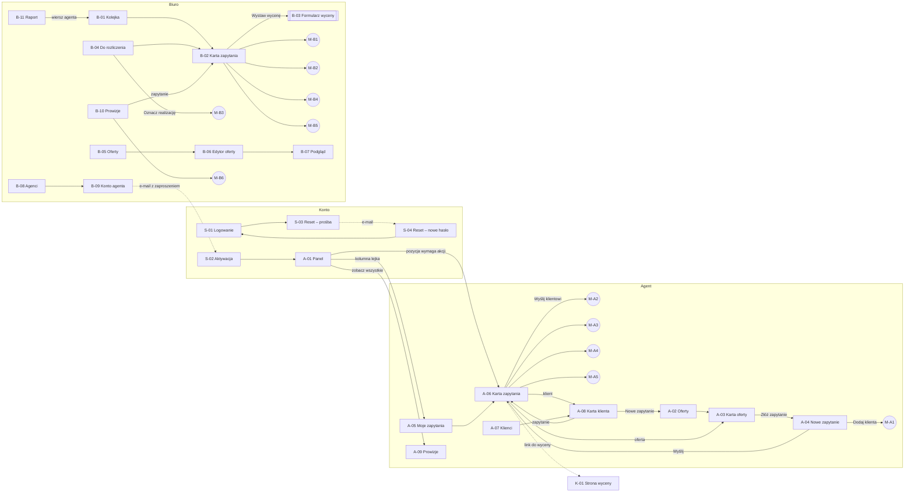

# Portal sprzedaży agencyjnej — mapa ekranów i nawigacji

Źródło: `00-zakres-funkcjonalny.md` · Data: 2026-10-13

Dokument definiuje identyfikatory ekranów, trasy, nawigację i katalog endpointów. Szczegóły każdego ekranu są w `02-specyfikacja-ekranow.md`, a klikalny prototyp w `mockup/index.html`.

## 1. Strefy portalu

| Strefa | Kto | Wejście | Powłoka |
|---|---|---|---|
| Publiczna – konto | Agent, pracownik biura | `/logowanie`, link z e-maila | Pojedyncza karta bez menu |
| Agent | Agent | po zalogowaniu → `/agent/panel` | Menu boczne (desktop) / dolny pasek zakładek (telefon) |
| Biuro | Pracownik biura | po zalogowaniu → `/biuro/kolejka` | Menu boczne, układ gęsty (desktop first) |
| Publiczna – wycena | Klient (nauczyciel) | link z tokenem `/w/{token}` | Strona bez menu, mobile first |

Po zalogowaniu system kieruje według roli. Agent nie ma dostępu do tras `/biuro/*` (403 → przekierowanie na panel), biuro nie korzysta z tras `/agent/*`.

## 2. Inwentarz ekranów

### 2.1 Wspólne (konto)

| ID | Ekran | Trasa | UC |
|---|---|---|---|
| S-01 | Logowanie | `/logowanie` | UC-A1 PA1 |
| S-02 | Aktywacja konta (ustaw hasło) | `/aktywacja/{token}` | UC-A1 PG, W1 |
| S-03 | Reset hasła – prośba | `/reset-hasla` | UC-A1 PA2 |
| S-04 | Reset hasła – nowe hasło | `/reset-hasla/{token}` | UC-A1 PA2 |

### 2.2 Agent

| ID | Ekran | Trasa | UC |
|---|---|---|---|
| A-01 | Panel agenta | `/agent/panel` | UC-A9, UC-S1 (uwaga) |
| A-02 | Oferty – wyszukiwarka | `/agent/oferty` | UC-A2 PG, PA1 |
| A-03 | Karta oferty | `/agent/oferty/{offerId}` | UC-A2 PG 4–5, PA2 |
| A-04 | Nowe zapytanie (formularz + szkic) | `/agent/zapytania/nowe?oferta={offerId}`, `/agent/zapytania/{id}/edycja` | UC-A4, UC-A3 PA1 |
| A-05 | Moje zapytania | `/agent/zapytania` | UC-A9 PA |
| A-06 | Karta zapytania (agent) | `/agent/zapytania/{inquiryId}` | UC-A5, UC-A6, UC-A7, UC-A8, UC-S1 |
| A-07 | Klienci | `/agent/klienci` | UC-A3 PG |
| A-08 | Karta klienta | `/agent/klienci/{clientId}` | UC-A3 PA2, PA3 |
| A-09 | Prowizje (agent) | `/agent/prowizje` | UC-A9 sekcja 4 |
| M-A1 | Modal: klient (dodaj / edytuj) | nad A-04, A-07, A-08 | UC-A3 |
| M-A2 | Modal: link do wyceny | nad A-06 | UC-A6 |
| M-A3 | Modal: prośba o zmianę | nad A-06 | UC-A7 PG |
| M-A4 | Modal: decyzja klienta (ręcznie) | nad A-06 | UC-A8 |
| M-A5 | Modal: wycofanie zapytania | nad A-06 | UC-A5 |

### 2.3 Biuro

| ID | Ekran | Trasa | UC |
|---|---|---|---|
| B-01 | Kolejka zapytań | `/biuro/kolejka` | UC-B3 PG 1 |
| B-02 | Karta zapytania (biuro) | `/biuro/zapytania/{inquiryId}` | UC-B3, UC-B5, UC-B6, UC-B7, UC-A7 PA1 |
| B-03 | Formularz wyceny (panel boczny) | nad B-02 | UC-B4 |
| B-04 | Do rozliczenia | `/biuro/do-rozliczenia` | UC-B6 PG 1 |
| B-05 | Oferty (lista) | `/biuro/oferty` | UC-B2 PA2–PA4 |
| B-06 | Edytor oferty | `/biuro/oferty/{offerId}`, `/biuro/oferty/nowa` | UC-B2 PG, W1 |
| B-07 | Podgląd oferty w widoku agenta | `/biuro/oferty/{offerId}/podglad` | UC-B2 PG 5 |
| B-08 | Agenci (lista) | `/biuro/agenci` | UC-B1 PG 4 |
| B-09 | Konto agenta (dodaj / edytuj) | `/biuro/agenci/nowy`, `/biuro/agenci/{agentId}` | UC-B1 PG, PA1–PA3 |
| B-10 | Prowizje (biuro) | `/biuro/prowizje` | UC-B9 |
| B-11 | Raport agentów | `/biuro/raport` | UC-B8 |
| M-B1 | Modal: odrzucenie zapytania | nad B-02 | UC-B3 PA1, UC-B5 PA1 |
| M-B2 | Modal: potwierdzenie rezerwacji | nad B-02 | UC-B5 |
| M-B3 | Modal: oznaczenie realizacji | nad B-02, B-04 | UC-B6 |
| M-B4 | Modal: anulowanie rezerwacji | nad B-02 | UC-B7 |
| M-B5 | Modal: zmiana warunków (powrót do wyceny) | nad B-02 | UC-B5 PA1 |
| M-B6 | Modal: oznacz wypłatę / cofnij wypłatę | nad B-10 | UC-B9 |

### 2.4 Klient

| ID | Ekran | Trasa | UC |
|---|---|---|---|
| K-01 | Strona wyceny | `/w/{token}` | UC-K1 PG, PA1, W1, W2 |

## 3. Nawigacja

### 3.1 Menu agenta

```
┌──────────────┐
│ ● Panel      │  licznik: pozycje „wymaga akcji”
│   Oferty     │
│   Zapytania  │  licznik: zapytania z nieprzeczytanym
│   Klienci    │
│   Prowizje   │
│ ──────────── │
│   Wyloguj    │
└──────────────┘
Telefon: dolny pasek 5 zakładek w tej samej kolejności, liczniki jako kropki.
```

### 3.2 Menu biura

```
┌──────────────────┐
│ ● Kolejka         │  licznik: Nowe + nieprzeczytane od agentów
│   Do rozliczenia  │  licznik: rezerwacje po dacie powrotu
│   Oferty          │
│   Agenci          │
│   Prowizje        │  licznik: należne do wypłaty
│   Raport agentów  │
│ ───────────────── │
│   Wyloguj         │
└──────────────────┘
```

### 3.3 Graf przejść



### 3.4 Kluczowe ścieżki (pokryte prototypem)

| # | Ścieżka | Ekrany |
|---|---|---|
| P1 | Biuro tworzy i publikuje ofertę | B-05 → B-06 (szkic, W1 braki) → B-07 → B-06 Opublikuj → B-05 |
| P2 | Biuro zakłada agenta, agent aktywuje konto | B-08 → B-09 → (e-mail) → S-02 → A-01 |
| P3 | Agent dodaje klienta i składa zapytanie | A-02 (filtry) → A-03 → A-04 (+ M-A1, ostrzeżenia) → A-06 [Nowe] |
| P4 | Biuro przejmuje i wycenia | B-01 → B-02 Przejmij [W wycenie] → B-03 → B-02 [Wycena gotowa] |
| P5 | Negocjacja | A-06 M-A3 [W wycenie] → B-02 B-03 v2 [Wycena gotowa] |
| P6 | Wysłanie linku i decyzja klienta | A-06 M-A2 [Wysłana] → K-01 Akceptuję [Zaakceptowana] |
| P6a | Decyzja przekazana telefonicznie | A-06 M-A4 [Zaakceptowana / Odrzucona (klient)] |
| P7 | Rezerwacja, realizacja, prowizja | B-02 M-B2 [Rezerwacja] → B-04 M-B3 [Zrealizowana] → B-10 M-B6 → A-09 |
| P8 | Ścieżki zamykające | A-06 M-A5 (wycofanie), B-02 M-B1 (odrzucenie), B-02 M-B4 (anulowanie) |
| P9 | Wygaśnięcie wyceny | A-01 „wymaga akcji” → A-06 baner „wycena wygasła” → M-A3 |
| P10 | Link nieaktualny | K-01 stan W1 / W2 |
| P11 | Raport → kolejka | B-11 → B-01 (filtr agent) |

## 4. Statusy zapytania (wspólny słownik UI)

| Kod API | Etykieta | Kto ma ruch | Kolor etykiety |
|---|---|---|---|
| `NEW` | Nowe | Biuro | atrament (kontur) |
| `QUOTING` | W wycenie | Biuro | atrament |
| `QUOTE_READY` | Wycena gotowa | Agent | zakreślacz (żółty) |
| `SENT_TO_CLIENT` | Wysłana do klienta | Klient / agent | niebo |
| `ACCEPTED` | Zaakceptowana | Biuro | sosna (kontur) |
| `BOOKING_CONFIRMED` | Rezerwacja potwierdzona | Biuro (po powrocie) | sosna |
| `COMPLETED` | Zrealizowana | — | sosna (pełny) |
| `CANCELLED` | Anulowana | — | szary |
| `REJECTED_BY_OFFICE` | Odrzucona (biuro) | — | szary |
| `REJECTED_BY_CLIENT` | Odrzucona (klient) | — | szary |
| `WITHDRAWN_BY_AGENT` | Wycofana (agent) | — | szary |

Flaga dodatkowa: `quoteExpired: true` przy `QUOTE_READY` bez aktywnej wyceny → plakietka „wycena wygasła” (marginesowa czerwień).

Statusy wyceny: `ACTIVE`, `SUPERSEDED` (Zastąpiona), `INVALIDATED` (Unieważniona), `EXPIRED` (Wygasła), `ACCEPTED`, `REJECTED`.
Statusy prowizji: `FORECAST` (prognozowana), `DUE` (należna), `PAID` (wypłacona), `CANCELLED` (anulowana).
Statusy agenta: `INVITED`, `ACTIVE`, `DEACTIVATED`. Statusy oferty: `DRAFT`, `PUBLISHED`, `WITHDRAWN`.

## 5. Katalog endpointów API

Prefiks `/api/v1`. Uwierzytelnienie sesyjne (cookie), role `AGENT` i `OFFICE`. Zasoby z wersją zwracają `ETag`, a mutacje wymagają `If-Match` (409 przy konflikcie). Błędy walidacji: 422 z listą `{field, code}`. Tokeny publiczne nieważne: 410.

### 5.1 Konto i sesja

| Metoda | Ścieżka | Rola | Ekrany |
|---|---|---|---|
| POST | `/auth/login` | — | S-01 |
| POST | `/auth/logout` | wszyscy | menu |
| GET | `/auth/me` | wszyscy | powłoka |
| GET | `/auth/activation/{token}` | — | S-02 (walidacja tokenu) |
| POST | `/auth/activation/{token}` | — | S-02 |
| POST | `/auth/password-reset` | — | S-03 |
| GET | `/auth/password-reset/{token}` | — | S-04 |
| POST | `/auth/password-reset/{token}` | — | S-04 |
| GET | `/me/counters` | wszyscy | liczniki menu (odpytywane co 60 s i po mutacji) |

### 5.2 Słowniki

| Metoda | Ścieżka | Rola | Ekrany |
|---|---|---|---|
| GET | `/dictionaries` | wszyscy | regiony, etapy edukacji, powody wycofania/odrzucenia |

### 5.3 Oferty

| Metoda | Ścieżka | Rola | Ekrany |
|---|---|---|---|
| GET | `/offers?region&daysMin&daysMax&stage&q&status` | AGENT (tylko `PUBLISHED`), OFFICE | A-02, B-05 |
| GET | `/offers/{offerId}` | AGENT, OFFICE | A-03, B-06, B-07 |
| GET | `/offers/{offerId}/pdf` | AGENT, OFFICE | A-03 |
| POST | `/offers` | OFFICE | B-06 (nowa) |
| PATCH | `/offers/{offerId}` | OFFICE | B-06 |
| POST | `/offers/{offerId}/publish` | OFFICE | B-06, B-05 |
| POST | `/offers/{offerId}/withdraw` | OFFICE | B-06, B-05 |
| POST | `/offers/{offerId}/duplicate` | OFFICE | B-05, B-06 |
| POST | `/offers/{offerId}/files` | OFFICE | B-06 (zdjęcia, PDF) |
| DELETE | `/offers/{offerId}/files/{fileId}` | OFFICE | B-06 |

### 5.4 Klienci (agent)

| Metoda | Ścieżka | Rola | Ekrany |
|---|---|---|---|
| GET | `/clients?q` | AGENT | A-07, A-04 (wybór) |
| GET | `/clients/{clientId}` | AGENT | A-08 |
| POST | `/clients` | AGENT | M-A1 |
| PATCH | `/clients/{clientId}` | AGENT | M-A1 |
| DELETE | `/clients/{clientId}` | AGENT | A-08 (409 gdy klient ma zapytania) |

### 5.5 Zapytania

| Metoda | Ścieżka | Rola | Ekrany |
|---|---|---|---|
| GET | `/inquiries?status&clientId&offerId&agentId&departureFrom&departureTo&sort` | AGENT (własne), OFFICE | A-05, A-08, B-01 |
| GET | `/inquiries/settlement-due` | OFFICE | B-04 |
| GET | `/inquiries/{inquiryId}` | AGENT, OFFICE | A-06, B-02 |
| POST | `/inquiries` (`submit: false` = szkic) | AGENT | A-04 |
| PATCH | `/inquiries/{inquiryId}` (tylko szkic) | AGENT | A-04 |
| POST | `/inquiries/{inquiryId}/submit` | AGENT | A-04 |
| POST | `/inquiries/{inquiryId}/withdraw` | AGENT | M-A5 |
| POST | `/inquiries/{inquiryId}/take-over` | OFFICE | B-02 |
| POST | `/inquiries/{inquiryId}/reject` | OFFICE | M-B1 |
| GET | `/inquiries/{inquiryId}/quotes` | AGENT, OFFICE | A-06, B-02 (historia wersji) |
| POST | `/inquiries/{inquiryId}/quotes` | OFFICE | B-03 |
| POST | `/inquiries/{inquiryId}/quotes/active/send` | AGENT | M-A2 (zwraca URL) |
| GET | `/inquiries/{inquiryId}/quotes/active/link` | AGENT | M-A2 (ponowne kopiowanie) |
| POST | `/inquiries/{inquiryId}/change-requests` | AGENT | M-A3 |
| POST | `/inquiries/{inquiryId}/client-decision` | AGENT | M-A4 |
| POST | `/inquiries/{inquiryId}/confirm-booking` | OFFICE | M-B2 |
| POST | `/inquiries/{inquiryId}/requote` | OFFICE | M-B5 |
| POST | `/inquiries/{inquiryId}/complete` | OFFICE | M-B3 |
| POST | `/inquiries/{inquiryId}/cancel` | OFFICE | M-B4 |
| GET | `/inquiries/{inquiryId}/messages` | AGENT, OFFICE | A-06, B-02 |
| POST | `/inquiries/{inquiryId}/messages` (multipart) | AGENT, OFFICE | A-06, B-02 |
| POST | `/inquiries/{inquiryId}/messages/read` | AGENT, OFFICE | A-06, B-02 (przy otwarciu) |
| GET | `/inquiries/{inquiryId}/history` | AGENT, OFFICE | A-06, B-02 |

### 5.6 Strona wyceny (publiczna)

| Metoda | Ścieżka | Rola | Ekrany |
|---|---|---|---|
| GET | `/public/quotes/{token}` | — | K-01 (200 aktywna, 200 z `decision` gdy podjęta, 410 nieaktualna) |
| POST | `/public/quotes/{token}/accept` | — | K-01 |
| POST | `/public/quotes/{token}/reject` | — | K-01 |

### 5.7 Panel i prowizje agenta

| Metoda | Ścieżka | Rola | Ekrany |
|---|---|---|---|
| GET | `/me/action-items` | AGENT | A-01 |
| GET | `/me/funnel` | AGENT | A-01 |
| GET | `/me/sales?from&to` | AGENT | A-01 |
| GET | `/me/commissions?status&from&to` (pozycje + sumy) | AGENT | A-01, A-09 |

### 5.8 Administracja i rozliczenia (biuro)

| Metoda | Ścieżka | Rola | Ekrany |
|---|---|---|---|
| GET | `/agents?status&q` | OFFICE | B-08, filtry B-01/B-10 |
| GET | `/agents/{agentId}` | OFFICE | B-09 |
| POST | `/agents` | OFFICE | B-09 |
| PATCH | `/agents/{agentId}` | OFFICE | B-09 |
| POST | `/agents/{agentId}/resend-invitation` | OFFICE | B-08, B-09 |
| POST | `/agents/{agentId}/deactivate` | OFFICE | B-09 |
| GET | `/commissions?status&agentId&from&to` | OFFICE | B-10 |
| POST | `/commissions/mark-paid` (`ids[]`, `paidOn`) | OFFICE | M-B6 |
| POST | `/commissions/{commissionId}/revert-payment` | OFFICE | M-B6 |
| GET | `/reports/agents?from&to` | OFFICE | B-11 |
